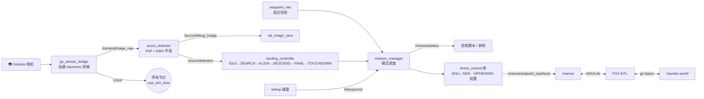
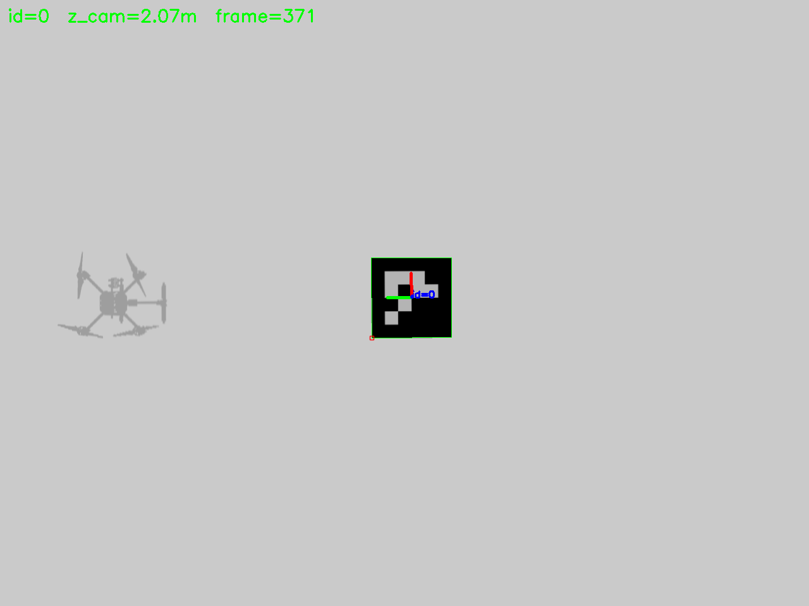
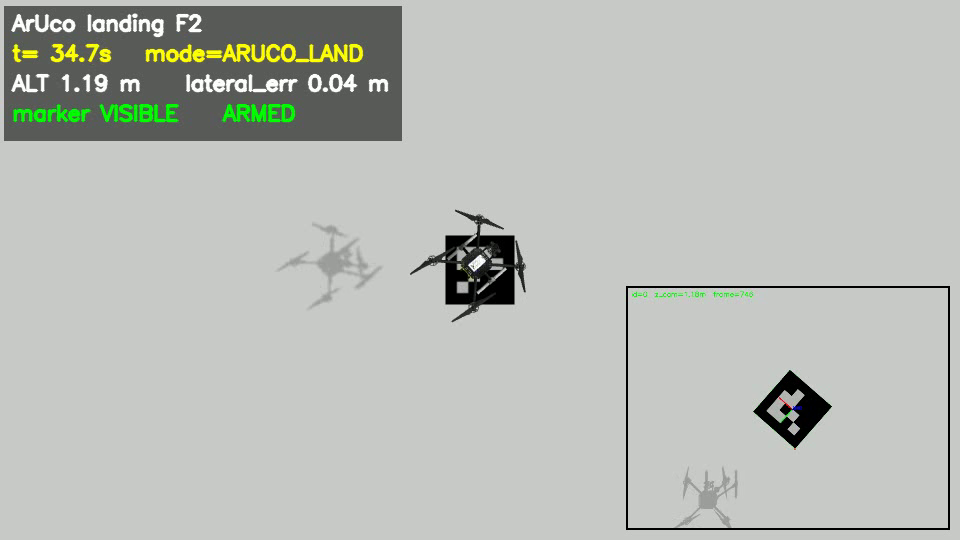

<div align="center">

# 🚁 无人机 ArUco 视觉自主降落仿真

**PX4 SITL + Gazebo Harmonic + ROS 2 Humble** · 从"起飞"到"用相机找到码并落到码上"的全链路实现


*多工位巡回：基站 → 三个工位逐个视觉降落 → 回基站（斜俯视机位 + 机载检测小窗）*

</div>

---

## ✨ 它能做什么

| 能力 | 说明 | 实测 |
|---|---|---|
| 🎯 **视觉降落** | ArUco 检测 → ENU 位姿 → 视觉伺服对准 → 分速度下降 → 上锁 | 落点水平误差 **0.01–0.10 m** |
| 🕹️ **手动遥控** | 键盘控制 + 一键切模式（手动 / 视觉降落 / 航点 / 全自主） | F1 全程无 crash |
| 🧭 **航点飞行** | 无障碍直线导航，三点巡航 | 稳态误差 **0.08–0.17 m** |
| 🤖 **全自主链路** | 起飞 → 航点 → 搜码 → 降落，**零人工输入** | 全程 **42.5 s** |
| 🛡️ **异常处理** | 下降中被遮挡 3 s：先回升再重搜，恢复后仍能落 | 回升 **1.87 m** |
| 🎬 **无窗口录视频** | 离屏机位 + 自建 gz 桥接 + HUD + 机载小窗，一条命令出 mp4 | 960×540 @ 25 fps |

**验收流程 5/5 PASS**：`F1` 手动 · `F2` 视觉降落 · `F3` 航点 · `F4` 全自主 · `F5` 遮挡异常，判据统计见 [docs/flows.md](docs/flows.md)。

---

## 🚀 快速开始

> 三步跑起来。首次运行前请先做下面「环境要求」里那两次一次性修补，否则会内存泄漏 / PX4 起不来。

```bash
# ① 起仿真（PX4 + Gazebo，约 60 s）
bash scripts/sim.sh start aruco

# ② 起任务链（检测 + 任务调度 + 降落控制器）
bash scripts/manual_demo.sh start

# ③ 看画面 / 遥控（各开一个终端）
bash scripts/manual_demo.sh view      # 检测叠加图：角点框 + 坐标轴 + 距离
bash scripts/manual_demo.sh teleop    # 键盘：Space 起飞，wasd 平移，2 视觉降落
```

> 只想知道键位和最短操作：👉 [**一页纸快速上手**](docs/quickstart.md)

<details>
<summary><b>⌨️ 键位表</b>（点开）</summary>

| 键 | 作用 | 键 | 作用 |
|---|---|---|---|
| `Space` | 起飞 1.5 m / 已起飞则降落 | `1` | 手动模式 |
| `w` `s` | 前进 / 后退 | `2` | **视觉降落** |
| `a` `d` | 左移 / 右移 | `3` | 航点飞行 |
| `r` `f` | 上升 / 下降 | `4` | 全自主 |
| `q` `e` | 左转 / 右转 | `0` | 降落 |
| `h` | 帮助 | `ESC` | 紧急降落（立即上锁） |

</details>

---

## 🧱 系统架构



设计上刻意守了两条约束：

1. **所有 setpoint 只有一个出口**（`drone_control`），`aruco_detector` 绝不发控制量；
2. **模式切换统一走"停旧模式 → HOVER 悬停 0.5 s → 启新模式"**，避免两个控制器同时发设定点打架（这是本项目最隐蔽的一类 bug）。

---

## 📦 环境要求与"一次性的两次修补"

| 依赖 | 版本 | 说明 |
|---|---|---|
| Ubuntu | 22.04 | WSL2 亦可（本工程即在 WSL2 上开发验证） |
| ROS 2 | Humble | `/opt/ros/humble` |
| Gazebo | Harmonic (`gz sim` 8.x) | 需要 `libgz-transport13` / `libgz-msgs10` |
| PX4 | v1.17（源码并已编译 `px4_sitl`） | 默认路径 `~/PX4-Autopilot` |
| OpenCV | 4.5.4（含 aruco） | `libopencv-aruco-dev` |
| 其他 | `mavros` `mavros_msgs` `cv_bridge` `rqt_image_view` | apt 安装 |

```bash
bash scripts/check_env.sh          # 一键体检
```

**两次修补（每台机器只需一次，脚本幂等，可 `restore` 还原）**：

```bash
bash scripts/fix_gz_plugins.sh apply   # 去掉 PX4 清单里会按帧泄漏内存的 GstCameraSystem
bash scripts/fix_gz_model.sh   apply   # 绕开 gz 富模型 merge 丢传感器的 bug
```

> 不做第一条：内存会一路涨到把机器拖死（实测 105 MB/s）。
> 不做第二条：PX4 报 `Preflight Fail: Accel Sensor 0 missing`，永远无法解锁。

---

## 🏁 五套验收流程

```bash
bash scripts/run_flow.sh F1      # 或 F2 / F3 / F4 / F5
```

| 流程 | 场景 | 判据 | 实测 | 结果 |
|---|---|---|---|---|
| **F1** | 纯手动：起飞 → 键盘飞一圈 → 降落 | 起飞 >1.2 m；最终 <0.2 m；无 crash | 起飞 1.95 m，落点 0.03 m | ✅ |
| **F2** | 手动飞到码附近 → 按 `2` 自动降落 | 水平 ≤0.25 m；高度 ≤0.25 m；≤150 s | 0.03 m / 0.04 m / 40.3 s | ✅ |
| **F3** | 纯自主飞三个航点 | 每点稳态误差 ≤0.35 m；≤180 s | 0.165 / 0.101 / 0.103 m，29.6 s | ✅ |
| **F4** | 全自主：起飞 → 航点 → 搜码 → 降落 | 零人工输入；水平 ≤0.25 m；≤180 s | 0.04 m，42.5 s | ✅ |
| **F5** | 全自主 + 下降中被遮挡 3 s | 回升 ≥1.0 m；不坠机；恢复后仍降落 | 回升 1.87 m，47.0 s | ✅ |

每条流程结尾打印 `[FLOW Fx] RESULT: PASS/FAIL`，失败会点名超了哪个指标。

---

## 🎬 看画面与录视频

| 方式 | 命令 | 适合 |
|---|---|---|
| 检测叠加图 | `bash scripts/manual_demo.sh view` | 看码的角点、坐标轴、距离、帧号 |
| Gazebo 3D | `bash scripts/manual_demo.sh gui` | 看整机姿态（WSL2 软件渲染下会偶发卡顿） |
| **离屏录制** | `bash scripts/record_video.sh F2 90 auto` | 出 mp4：斜俯视机位 + HUD + 机载小窗 |
| 多工位巡回 | `bash scripts/demo_tour.sh 280` | 基站 → 3 个工位 → 回基站，全程录制 |

<div align="center">


</div>

---

## 🖥️ 部署到实机（推荐配置）

> 这一节按**一套具体配置**写，不写"视情况而定"。换成别的硬件时，只需要动下表右列的对应项。

### 推荐配置

| 部件 | 推荐型号 | 为什么 |
|---|---|---|
| 飞控 | **Pixhawk 6C / 6X**（PX4 固件） | 双 TELEM 口、IMU 冗余，PX4 参数与仿真一致 |
| 机载计算机 | **树莓派 5（8 GB）** + Ubuntu 22.04 arm64 + ROS 2 Humble | Pi 5 的 CPU 足够跑 1280×960@30 的 ArUco 检测；Pi 4 建议降到 640×480 |
| 相机 | **USB 广角相机**（或 CSI IMX477 + `camera_ros`） | 朝下安装，光轴与机体 −z 对齐（与仿真机位一致） |
| 定位 | **室外：GPS**；室内：**PMW3901 光流 + 激光测距** | 没有水平/高度观测时 PX4 的 EKF 不会给位姿，直接无法解锁 |
| 连接 | **飞控 TELEM2 ↔ Pi UART，921600** | 不要用 WiFi 连飞控：抖动会让 OFFBOARD 掉模式 |
| 供电 | 独立 **5V/5A BEC** 给 Pi | 不要从飞控取电，否则重启会拉垮飞控 |

### 只需要改这几处

| 改哪里 | 改成什么 |
|---|---|
| `drone_bringup/config/mavros.yaml` → `fcu_url` | `serial:///dev/ttyAMA0:921600`（USB-TTL 则 `serial:///dev/ttyUSB0:921600`） |
| `drone_bringup/config/aruco.yaml` → `marker_size` | 实测打印出的**黑框外沿**边长（米）；仿真实测标定值为 `0.487` |
| `drone_bringup/config/aruco.yaml` → `camera_fx/fy/cx/cy` | 相机标定结果（若相机已发 `camera_info`，这里留 0 也可） |
| 所有 launch | `use_sim_time:=false`，且**不要**启动 `sim_bringup.launch.py` 与 `/clock` 桥接 |

**PX4 侧还要设 4 个参数**（QGC 里改，或 `bash scripts/set_px4_param.py <名> <值>`）：

```
MAV_1_CONFIG   = TELEM 2        # 把该串口切到 MAVLink
SER_TEL2_BAUD  = 921600
COM_OF_LOSS_T  = 1.0            # OFFBOARD 失联超时，给大一点更稳
COM_OBL_RC_ACT = 切回定高        # 失联时不要"继续执行"
```

### 上机前按这个顺序验证（每步过了再下一步）

1. **地面定点**：`/mavros/state` 的 `connected=true`，且 `/mavros/local_position/pose` 有数据、`z` 不漂 → 说明 EKF 有位姿；
2. **2 m 悬停看检测**：`/aruco/detection` 位姿稳定（对应仿真里的 `scripts/m1_check_detection.py`）；
3. **半程降落**：把 `align_alt` 改到 1.5、`descend_speed` 改到 0.15 试一次 `ARUCO_LAND`；
4. **完整链路**：最后才放开 `AUTO`（航点 + 搜码 + 降落）。

### 三条安全红线

- **`NAV_DLL_ACT` 保持默认**（仿真里为了绕开"无地面站"才置 0，实机会让失控保护失效）；
- **遥控器随时能切回 `POSCTL`** 接管，降落段建议手不离杆；
- 桨叶护罩 + 设 geofence；相机支架加减震（震动会让角点抖到解算发散）。

> ⚠️ 实机部分是基于仿真代码结构与 PX4/ROS 2 通用做法整理的，**尚未在真机上验证**；仿真的验收数据（F1–F5）才是实测结果。

---

## 📁 目录结构

```
ArUco_Drone/
├── ArUco_Drone_ws/src/
│   ├── drone_interfaces/   自定义消息与服务
│   ├── drone_bringup/      launch / 参数 / 自建 gz 模型与桥接
│   ├── drone_control/      飞控封装库（ENU↔NED、OFFBOARD 前置）
│   ├── drone_aruco/        ArUco 检测 + 视觉伺服降落
│   ├── drone_nav/          航点导航
│   ├── drone_mission/      模式调度（MANUAL/HOVER/ARUCO_LAND/WAYPOINT/AUTO/TOUR）
│   ├── drone_teleop/       键盘遥控
│   └── drone_tools/        验收脚本与录制工具
├── scripts/                一键脚本 → 清单见 scripts/README.md
├── docs/                   流程、踩坑、阶段报告、手动测试
└── logs/                   bag 与视频（不入库）
```

## 📚 文档导航

| 文档 | 内容 |
|---|---|
| [一页纸快速上手](docs/quickstart.md) | 三步起仿真 + 键位 |
| [五套验收流程](docs/flows.md) | 每套怎么跑、判据怎么算 |
| [手动测试与看画面](docs/manual_test.md) | 完整手动测试清单、三种看画面方式 |
| [录制演示视频](docs/video_demo.md) | 离屏机位原理与参数 |
| [踩坑排查](docs/troubleshooting.md) | 33 条真实踩过的坑与判定命令 |
| [阶段成果报告](docs/stage_reports.md) | M0–M6 每阶段实现、实测数据与决策理由 |
| [脚本清单](scripts/README.md) | 38 个脚本各干什么 |

## 🤝 致谢

依赖 [PX4-Autopilot](https://github.com/PX4/PX4-Autopilot)（BSD-3）、[Gazebo](https://gazebosim.org/)（Apache-2.0）、[ROS 2](https://docs.ros.org/)（Apache-2.0）、[OpenCV](https://opencv.org/)（Apache-2.0）。本工程代码为自研，采用 Apache-2.0 许可。
