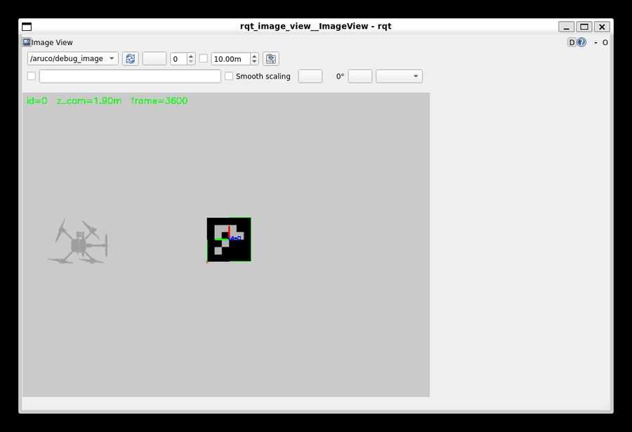
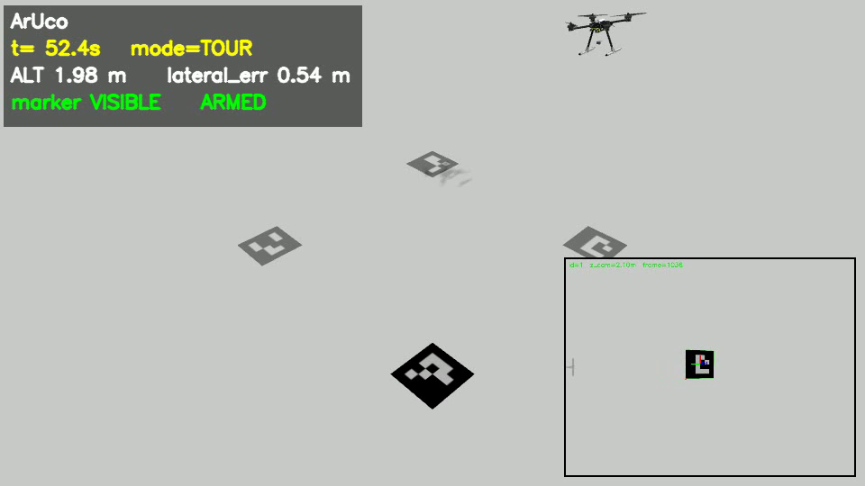

# 手动测试与看画面指南

> 面向"我想自己跑一下、看看画面"的场景。所有命令都在 **WSL 终端**里执行，
> 图形窗口默认直接弹在 Windows 桌面上（WSLg）；如果 3D 窗口卡，可以改用 MobaXterm 的 X server（见 §6）。
> 想要一段能直接发出去的视频，用 `docs/video_demo.md` 那条管线。
> 本文的每条命令与每张图都是在本机实机跑出来的。

---

## 0. 先说结论：三种看画面的方式

| 方式 | 命令 | 能看到什么 | 稳定性 |
| --- | --- | --- | --- |
| **图像窗口（推荐）** | `bash scripts/manual_demo.sh view` | 相机原始画面 + 检测叠加（绿色角点框、RGB 坐标轴、`id=0 z_cam=1.90m frame=3800`） | 稳定，实测多次 |
| **Gazebo 3D** | `bash scripts/manual_demo.sh gui` | 3D 世界：无人机、地面黑色码板、影子、Entity Tree | 可用；WSLg 是远程渲染，偶尔窗口需要拖一下/缩放一下才重绘 |
| **抓帧存 PNG（保底）** | `python3 scripts/m1_save_debug.py /tmp/shot.png` | 单帧 `/aruco/debug_image` 存成文件 | 100% 可靠，无窗口依赖 |
| **X server（可选）** | 见 §6 | 与 Gazebo 3D 相同，但走 MobaXterm 自带的 X.Org，不经过 WSLg 的远程桌面通道 | 实测可正常渲染（见 §6） |

两种窗口都可以随时关掉，**不影响仿真**（GUI 是独立进程，连的是正在跑的 gz server）。

---

## 1. 三步启动

### 第 1 步：起仿真（一个终端，约 60~90 秒）

打开 WSL 终端：`Win + R` → 输入 `wsl -d Ubuntu-22.04 -u luosury` → 回车，然后：

```bash
cd ~/ArUco_Drone
bash scripts/manual_demo.sh start
```

正常输出（实测）：

```
[manual] 起 SITL（含 IMU 健康检查，约 60~90 s）…
[healthy] 第 1 次启动 SITL → IMU 有发布者
[sim] PX4 就绪
[manual] 起 F2 链路（桥接 + MAVROS + 检测 + 降落控制器 + 任务调度）…
[manual] 全部就绪（3s）

接下来在**另外的终端**里：
  bash scripts/manual_demo.sh gui      # 3D 世界
  bash scripts/manual_demo.sh view     # 相机 + 检测叠加
  bash scripts/manual_demo.sh teleop   # 键盘飞（按 h 看键位）

[sim] PX4 运行中 pid=6853
[sim] 世界 RTF / 迭代数：
iterations: 3273
real_time_factor: 0.926806177255852
[sim] 相机话题数：1
```

**看到 `real_time_factor ≈ 0.9~1.0` 才算正常**（这个数是"仿真跑得多快"，
1.0 = 实时）。如果掉到 0.1 以下，先关掉 GUI 窗口再看。

这一步之后无人机还停在原地（`mode = IDLE`，未解锁），不会自己飞。

### 第 2 步：开画面（另一个终端）

```bash
cd ~/ArUco_Drone
bash scripts/manual_demo.sh view     # 相机 + 检测叠加（推荐）
bash scripts/manual_demo.sh gui      # 3D 世界
```

也可以看原始相机（不带检测叠加）：

```bash
bash scripts/manual_demo.sh view raw    # 话题换成 /camera/image_raw
```

### 第 3 步：键盘飞（第三个终端，必须是交互终端）

```bash
cd ~/ArUco_Drone
bash scripts/manual_demo.sh teleop
```

启动后会打印键位表；**输入焦点要在这个终端窗口里**，按 `h` 可随时重打。

---

## 2. 键盘键位

```
w / s    前进 / 后退        a / d    左移 / 右移
r / f    上升 / 下降        q / e    左偏航 / 右偏航
Space    未起飞 = 起飞到 1.5 m；已起飞 = 降落
1  MANUAL（手动）      2  ARUCO_LAND（视觉降落，先飞到码附近）
3  WAYPOINT（航点）    4  AUTO（全自主：航点 → 搜码 → 降落）
0  立即降落（LAND）      ESC / Ctrl-C  紧急降落      h  帮助
```

- 速度由 `config/flows.yaml` 的 `teleop_max_vel`(0.5 m/s) / `teleop_max_vert`(0.4) / `teleop_max_yaw`(0.5 rad/s) 决定。
- 松键 **300 ms** 内速度自动清零（定时器兜底，即使终端丢字符也不会一直飞）。
- `w/s/a/d` 是**机体系**：机头朝哪，"前进"就往哪。

---

## 3. 一次完整的手动测试（照这个顺序走）

| 步骤 | 操作 | 预期现象 |
| --- | --- | --- |
| 1 | `manual_demo.sh start` | `[manual] 全部就绪`，RTF ≈ 1.0，相机话题数 1 |
| 2 | `manual_demo.sh view` | 窗口出现，**地面时红字 `no marker`**（相机贴地看不到码，正常） |
| 3 | `manual_demo.sh gui` | 3D 窗口里能看到无人机停在黑色码板正中间 |
| 4 | `manual_demo.sh teleop` 里按 `Space` | 无人机爬升到 1.5 m 悬停；图像窗口红字变成绿字 `id=0 z_cam=1.5m frame=…`，码上出现角点框与 RGB 坐标轴 |
| 5 | 按 `w` 两秒 | 无人机前飞，画面里码向左移出又移回；再按 `s` 回来 |
| 6 | 按 `2` | 进入视觉降落：`ALIGN → DESCEND → FINAL → TOUCHDOWN`，图像里码越来越大直到看不见，最后自动上锁 |
| 7 | 按 `0` 或 `Space` | 随时可以立即降落 / 降落 |
| 8 | `manual_demo.sh stop` | 仿真、所有节点、两个窗口全部关掉 |

第 4 步的画面（实测截图，`/aruco/debug_image`）：



第 3 步的 3D 世界（实测截图）：



---

## 4. 随时检查状态

```bash
bash scripts/manual_demo.sh status
```

```
[sim] PX4 运行中 pid=6853
iterations: 4821
real_time_factor: 0.99087724096177521
[sim] 相机话题数：1
--- 关键话题 ---
  /clock: 有发布者
  /camera/image_raw: 有发布者
  /aruco/detection: 有发布者
  /mavros/state: 有发布者
  /mission/status: 有发布者
```

看具体数值：

```bash
# 飞控状态（是否连上、是否解锁、当前模式）
ros2 topic echo /mavros/state --once --no-daemon

# 任务状态（高度、水平误差、是否看到码、是否解锁）
ros2 topic echo /mission/status --once --no-daemon
```

`/mission/status` 的实测例子（悬停 1.87 m 时）：

```
state: MANUAL
mode: MANUAL
flow: F2
altitude: 1.870530366897583
lateral_error: 0.056041691452264786
vertical_speed: -0.007393560837954283
marker_visible: true
armed: true
```

`lateral_error` 是"无人机到码的水平距离"，`marker_visible = true` 表示检测到了码。

---

## 5. 收尾

```bash
bash scripts/manual_demo.sh stop
```

```
[manual] 停 ROS 节点…
[manual] 关 GUI 窗口…
[manual] 停 SITL…
[manual] 已全部停止
```

只关窗口不跑 stop 也可以，但仿真会继续占 CPU。**下次再 start 之前建议先 stop**，
否则可能出现两套节点同时发设定点（我们踩过这个坑，见 `docs/troubleshooting.md` 第 29 条）。

---

## 6. 用 MobaXterm 的 X server 跑 3D 窗口（可选）

WSLg 的 3D 窗口有概率卡住（鼠标点菜单还有反应，但视口不动）。如果本机装了 MobaXterm，
可以让 Gazebo 走它自带的 X server，绕开 WSLg 的远程桌面合成通道。

**先确认 X server 在起作用**（在 WSL 里）：

```bash
pgrep -a XWin_MobaX                     # 看到 XWin_MobaX.exe 就说明它在跑
DISPLAY=127.0.0.1:0 xdpyinfo | head -6  # 应输出 name of display / version / GLX 存在
```

实测输出（本机）：

```
name of display:    127.0.0.1:0
version number:     11.0
vendor string:      The X.Org Foundation
vendor release number: 12013005
dimensions:         1024x768
```

然后**只把 GUI 指过去**（仿真本体不用动，它本来就是 headless 跑的）：

```bash
export DISPLAY=127.0.0.1:0
source ~/PX4-Autopilot/build/px4_sitl_default/rootfs/gz_env.sh
gz sim -g --render-engine ogre
```

要点与实测结论：

- MobaXterm 自带的是 **X.Org 1.20.13（XWin 系）且支持 GLX**，所以 `gz sim -g` 不会报
  `Unable to create OpenGL context`，3D 视口能正常渲染出无人机与码板；
- 它的显示尺寸是 **1024×768**（比 WSLg 的窗口小），想大一点在 MobaXterm 的 X11 设置里调；
- 只是"看画面"的话，`DISPLAY` 只影响那一条命令，不影响你已经起好的仿真；
- 想恢复 WSLg：`unset DISPLAY` 即可（WSLg 默认就是 `:0`，别长期 export 在 shell 里）。

> 注意：`rqt_image_view` 建议继续用 WSLg（它重绘不频繁，本来就不卡）；
> X11 下的 Qt 窗口在某些主题下字体可能发虚。

---

## 7. 常见问题

| 现象 | 原因 | 处理 |
| --- | --- | --- |
| 图像窗口一直红字 `no marker` | 无人机还在地面，相机贴地看不到码 | 按 `Space` 起飞后就会变成绿字 `id=0 z_cam=…` |
| 图像窗口全灰、没有 `no marker` 也没有图 | 还没收到帧 | 确认 `manual_demo.sh status` 里 `/camera/image_raw` 有发布者；再等 2~3 秒 |
| Gazebo 窗口里 3D 一片空白（只剩右侧属性面板） | WSLg 远程渲染偶尔不重绘 | 在 3D 区域用鼠标左键拖一下或滚轮缩放一下；还不行就关掉窗口重新 `manual_demo.sh gui` |
| `teleop` 报"键盘遥控需要交互式终端" | 命令被 `nohup`/管道/launch 启动了，stdin 不是 TTY | 在 Windows 里单独开一个 WSL 终端，直接运行该命令 |
| `teleop` 按了没反应 | 输入焦点在别的窗口（比如 rqt） | 点一下 teleop 所在的终端窗口再按 |
| `real_time_factor` 掉到 0.1 以下 | 有别的重负载（多个 GUI、残留进程） | `manual_demo.sh stop` 后重新 `start`；GPU 加速在这个 WSL 里不可用，只能靠 Ogre1 软件渲染 |
| `[sim] PX4 已在运行` 但连不上 | 上次的进程没退干净 | `bash scripts/manual_demo.sh stop`，必要时 `wsl --shutdown` 后重来 |
| 想看更细的日志 | — | 节点日志在 `/tmp/manual_demo.log`，PX4 在 `logs/px4_sitl.log` |

---

## 8. 这套东西背后的两个环境事实（避免误判）

1. **WSL2 里没有 `/dev/dri`**，Gazebo 只能用 Ogre1 软件渲染，所以 `sim.sh` 强制
   `PX4_GZ_SIM_RENDER_ENGINE=ogre` + `HEADLESS=1`（不启 PX4 自带的 GUI）。
   我们额外开的 `gz sim -g` 是**独立的 GUI 客户端**，不参与物理步进，所以它卡不会拖慢仿真。
2. **`ros_gz_bridge` 在这个环境里是坏的**（apt 版是 Fortress ABI，与 Harmonic 的
   `gz-transport13` 不兼容，永远收不到数据）。相机与 `/clock` 由我们自己的
   `drone_bringup/gz_sensor_bridge` 直连 gz-transport13，所以 `view` 能出图。

---

## 9. 相关文件

| 文件 | 用途 |
| --- | --- |
| `scripts/manual_demo.sh` | 本指南用到的全部子命令（start/gui/view/teleop/status/stop） |
| `scripts/m1_save_debug.py` | 保底方案：把一帧 `/aruco/debug_image` 存成 PNG |
| `config/flows.yaml` | 遥控速度上限、任务参数 |
| `config/aruco.yaml` | 检测参数（字典、`marker_size`、EMA 平滑系数） |
| `docs/flows.md` | 五套自动验收流程（F1~F5） |
| `docs/troubleshooting.md` | 33 条实测踩坑 |
